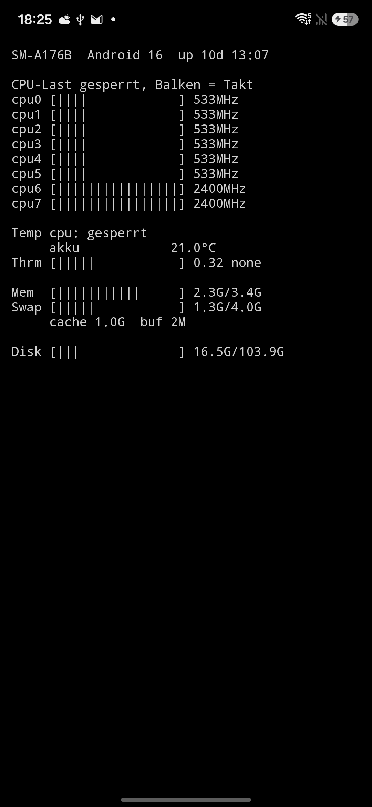

# osview

A **tiny htop-style system monitor for Android** — one screen of monospace text,
refreshed every second. No dependencies, no permissions, a ~20 KB APK.

<p>
  
</p>

## What it shows

- **Header** — device model, Android version, uptime, load average (where readable)
- **CPU** — overall and per-core load with a bar per core, plus the current clock.
  Where `/proc/stat` is locked (most devices today), the bars show the clock relative
  to the core's maximum instead, and the screen says so. Offline cores are marked.
- **Temperature** — CPU thermal zones (Qualcomm, MediaTek, Tensor/Exynos naming),
  listed individually or as average/max when there are many; the battery temperature;
  the system's thermal headroom (1.0 = heavy throttling ahead) and thermal status.
- **Memory** — RAM, swap, cache and buffers
- **Disk** — used/total of the data partition

Polling runs only while the app is visible, on a background thread.

## What it can't show

An ordinary app sees only what SELinux allows, and vendors differ. On a Samsung
Galaxy A17, for example, both CPU load and the CPU thermal zones are locked — osview
then says *locked* rather than guessing, and falls back to what is available (clock
speeds, battery temperature, thermal headroom). No root, no workarounds.

## Languages

English and German, following the system language. Column labels (`CPU`, `Mem`,
`Swap`, `Disk`, `Temp`, `Thrm`) stay the same in both, htop style.

## Build

Requirements: JDK 21, Android SDK 36.

```sh
./gradlew bundleRelease       # unsigned release AAB in app/build/outputs/bundle/release/
./gradlew testDebugUnitTest   # JVM unit tests
```

Android 16+ only (`minSdk 36`). Kotlin via AGP 9's built-in Kotlin, no Compose, no
AndroidX — just the platform and the Kotlin stdlib, shrunk with R8.

## Structure

| File | Role |
|---|---|
| `MainActivity.kt` | Reads `/proc`, `/sys`, `StatFs`, `PowerManager`, the battery broadcast; renders the text |
| `SysParse.kt` | Pure parsing and formatting — no Android types, covered by JVM tests |

## License

To be added.
